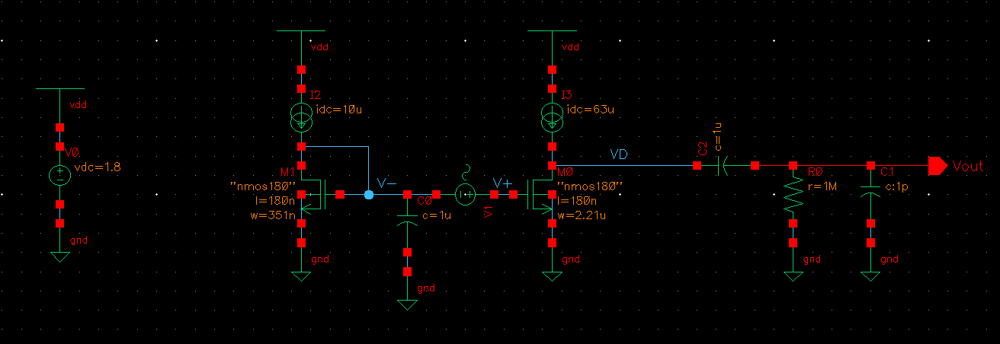
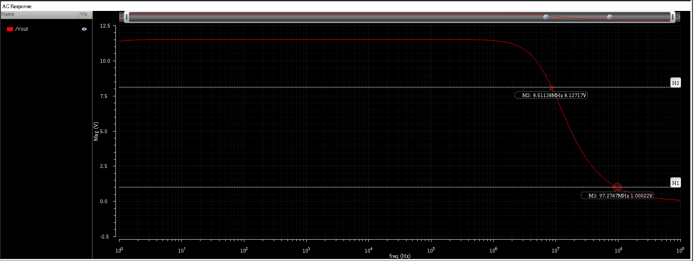
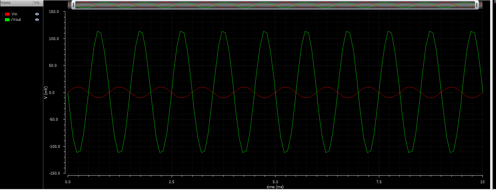

# Common Source Amplifier with Ideal Current Source Load

## Overview

The project is targeted towards designing a CS amplifier using an ideal current source as a load using 180 nm technology process node. The main aim is to use gm/Id design methodology.

## Design Specifications

| Parameter                | Symbol     | Given/Target Value | Unit |
| ------------------------ | ---------- | ------------------ | ---- |
| **Supply Voltage**       | $V_{DD}$   | 1.8                | V    |
| **Bias Current Source**  | $I_{bias}$ | 10                 | µA   |
| **Power Budget**         | $P{_{dc}}$ | $\le$ 150          | µW   |
| **Technology Node**      | $L_{min}$  | 180                | nm   |
| **Voltage Gain**         | $A_v$      | **$\ge$** 10       | V/V  |
| **Unity Gain Bandwidth** | $B_W$      | 100                | MHz  |
| **Load Resistance**      | $R_L$      | 1                  | MΩ   |
| **Load Capacitance**     | $C_L$      | 1                  | pF   |

## Simulation Results

| Parameter                | Expected / Target | Simulated Result | Remarks                                                                      |
| ------------------------ | ----------------- | ---------------- | ---------------------------------------------------------------------------- |
| **Gain (**$A_v$**)**     | **$\ge$** 10 V/V  | 11.5 V/V         | Simulated gain is higher due to the choice of gm/Id.                         |
| **$g_m$ / $I_d$**        | 10 V $^{-1}$      | 9.75 V $^{-1}$   | gm/Id was chosen such that transistor operates in moderate inversion region. |
| **3-dB Bandwidth**       | 10 MHz            | 8.5 MHz          | -                                                                            |
| **Unity Gain Bandwidth** | 100 MHz           | 97 MHz           | -                                                                            |
| **Power Budget**         | $\le$ 150  µW     | 131.4 µW         | Power Budget is satisfied                                                    |

## Schematics and Plots

### 1. Circuit Schematic

### 2. AC Analysis 

### 3. Transient Analysis

## Key Observations, Inferences & Takeaways

* **Trade-off between Gain and Bandwidth:** There is a clear tradeoff between gain and bandwidth. As the gain increases, the bandwidth decreases. 

* **Length Selection:** Choice of channel length of the MOS device is crucial. Depending on the specifications and application, L can be chosen. Larger L corresponds to larger intrinsic gain, but lower bandwidth. Shorter channel lengths have a lower intrinsic gain, a larger bandwidth, but they also suffer from short channel effects which have to be accounted for. In this design, L is chosen to be 180nm for convenience. 

* **gm/Id Selection:** gm/Id acts as a degree of freedom for us which enables us to tune it to vary the parameters of the MOS device. In this design, gm/Id is chosen to be 10, so that the MOS device operates in moderate inversion. Moderate inversion provides benefits of both strong inversion (higher bandwidth) and weak inversion (higher gain).

## Note and Future Improvements

* **Note:** The MOS model used is a 180nm Predictive Technology Model (PTM).

* **Future Work:**
  * Implementation of the ideal current source using transistors, to provide a realistic view of the current source and the amplifier as a whole.
