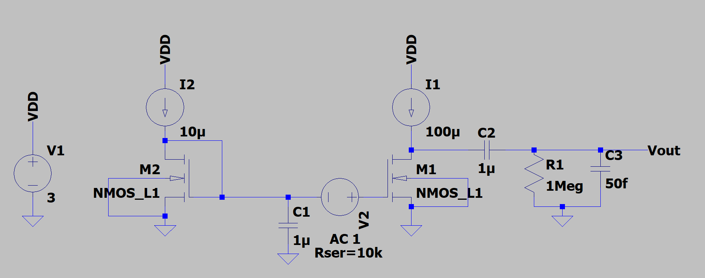
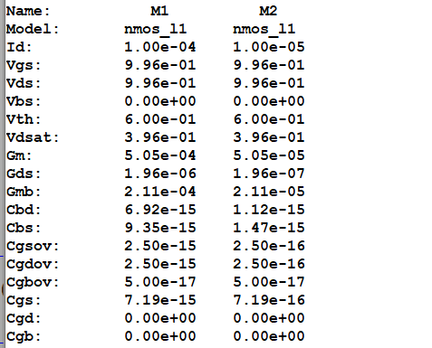
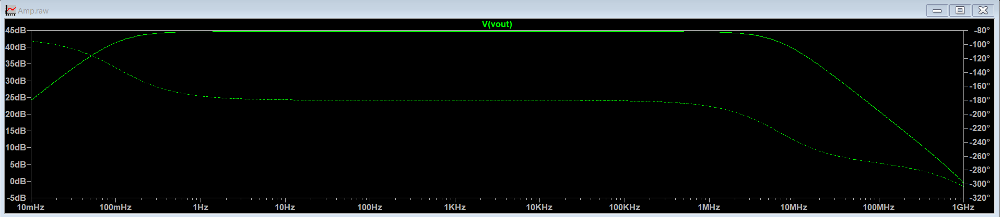
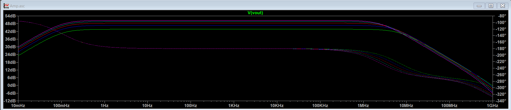
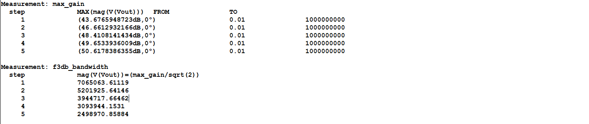
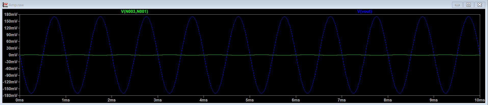

# Common Source Amplifier with Ideal Current Source Load

## Overview

The project is targeted towards designing a CS amplifier using an ideal current source as a load using 0.5µm technology process node. The main aim is to obtain a high gain and observe the trade-off for bandwidth. 

## Design Specifications

| Parameter               | Symbol     | Given/Target Value | Unit |
| ----------------------- | ---------- | ------------------ | ---- |
| **Supply Voltage**      | $V_{DD}$   | 3                  | V    |
| **Bias Current Source** | $I_{bias}$ | 10                 | µA   |
| **Power Budget**        | $P_{dc}$   | $\le$ 360          | µW   |
| **Technology Node**     | $L_{min}$  | 0.5                | µm   |
| **Voltage Gain**        | $A_v$      | 250                | V/V  |
| **Load Resistance**     | $R_L$      | 1                  | MΩ   |
| **Load Capacitance**    | $C_L$      | 50                 | fF   |

## Simulation Results

| Parameter             | Expected / Target | Simulated Result | Deviation (%) | Remarks                                                                                                                                   |
| --------------------- | ----------------- | ---------------- | ------------- | ----------------------------------------------------------------------------------------------------------------------------------------- |
| **Gain (**$A_v$**)**  | 250 V/V           | 170.4 V/V        | 31.84 %       | Gain is lower because of the load resistance. If the load resistance is also considered, the gain obtained is close to the expected gain. |
| **3-dB Bandwidth**    | 6.61 MHz          | 6.50 MHz         | 1.66 %        | -                                                                                                                                         |
| **Power Consumption** | $\le$ 360 µW      | 330 µW           | -             | The power budget is satisfied.                                                                                                            |

## Schematics and Plots

### 1. Circuit Schematic

### 2. DC Analysis & Operating Point

### 3. AC Analysis (Bode Plot)

Parametric AC Response with W as a parameter

Note: W is varied from 1µm to 5µm in steps of 1µm.
### 4. Transient Analysis

## Key Observations, Inferences & Takeaways

* **Trade-off between Gain and Bandwidth:** There is a clear tradeoff between gain and bandwidth. As the gain increases the bandwidth decreases. 

* **Loading:** The gain was lower than expected because of the load resistance. 

* **Sizing Impact:** Sizing impacts both gain and bandwidth. Here, gain is proportional to $\sqrt{WL}$, whereas the bandwidth is proportional to $W^{-1/2}L^{-3/2}$. So we can clearly observe the gain bandwidth tradeoff here also. Since, bandwidth has a stronger dependency on L, only W is varied to obtain the required gain while maximizing bandwidth.

## Note and Future Improvements

* **Note:** The MOS model used is a level 1 model, where the parameters chosen are arbitrary but realistically within the range. The model used for the 0.5µm node might not be realistic, but it provides for easy hand calculations and intuition for the design.

* **Future Work:**
  * Implementation using accurate and realistic BSIM3/BSIM4 models, and moving to a smaller technology nodes like 180nm.

