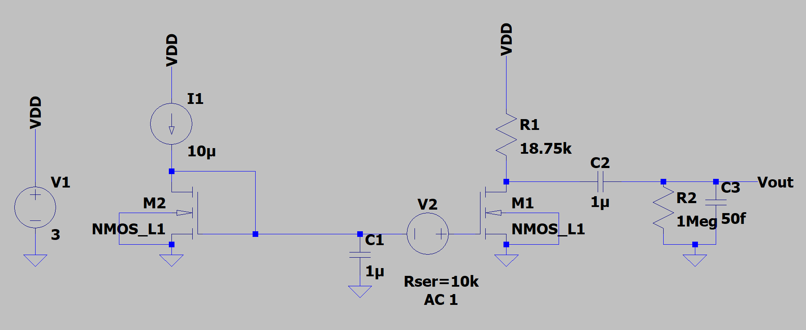
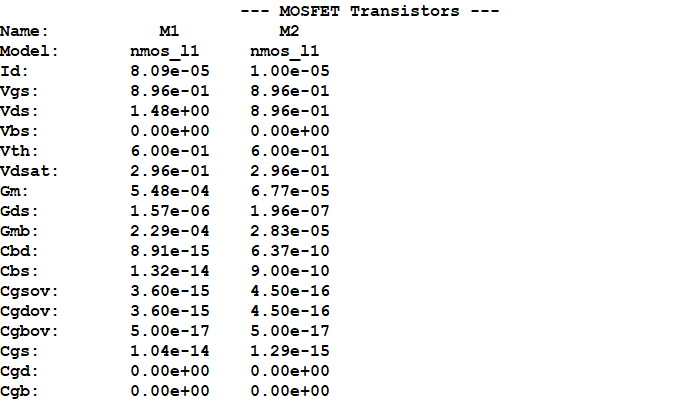
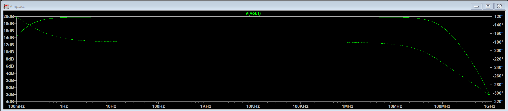
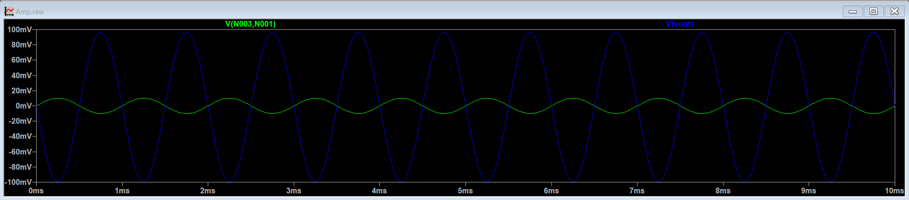
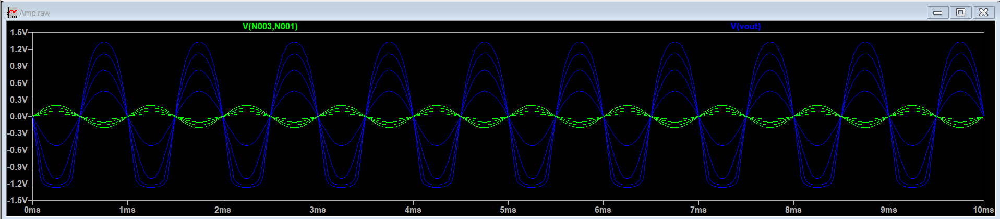

# Common Source Amplifier with Resistive Load

## Overview

The project is targeted towards designing a CS amplifier using resistive load . Technology process node used for the design is 0.5µm. 

## Design Specifications

| Parameter               | Symbol     | Given/Target Value | Unit |
| ----------------------- | ---------- | ------------------ | ---- |
| **Supply Voltage**      | $V_{DD}$   | 3                  | V    |
| **Bias Current Source** | $I_{bias}$ | 10                 | µA   |
| **Power Budget**        | $P_{dc}$   | $\le$ 300          | µW   |
| **Technology Node**     | $L_{min}$  | 0.5                | µm   |
| **Voltage Gain**        | $A_v$      | $\ge$ 10           | V/V  |
| **3-dB Bandwidth**      | $B_W$      | $\ge$ 100          | MHz  |
| **Load Resistance**     | $R_L$      | 1                  | MΩ   |
| **Load Capacitance**    | $C_L$      | 50                 | fF   |

## Simulation Results

| Parameter             | Expected / Target | Simulated Result | Deviation (%) | Remarks                                       |
| --------------------- | ----------------- | ---------------- | ------------- | --------------------------------------------- |
| **Gain (**$A_v$**)**  | 10 V/V            | 9.79 V/V         | 2.1 %         | Gain is lower because of the load resistance. |
| **3-dB Bandwidth**    | 97.3 MHz          | 103.4 MHz        | 6.27 %        | -                                             |
| **Power Consumption** | $\le$ 360 µW      | 272.7 µW         | -             | The power budget is satisfied.                |

## Schematics and Plots

### 1. Circuit Schematic

### 2. DC Analysis & Operating Point

### 3. AC Analysis (Bode Plot)

### 4. Transient Analysis

Transient Response with variation in input signal

From the plot, we can observe that $V_{sig}$ beyond 100 mV causes the output signal to clip on the negative side. 
## Key Observations, Inferences & Takeaways

* **Trade-off between Gain and Bandwidth:** There is a clear tradeoff between gain and bandwidth. As the gain increases the bandwidth decreases. 

* **Sizing and Resistance Impact:** Sizing and drain resistance impacts both gain and bandwidth. gain is proportional to $\sqrt{W/L}$ $R_{D}$  and bandwidth is proportional to $W^{-1}L^{-1}$ $R_{D}$. 

- **Input Swing:** $R_{D}$  also determines the swing. If $R_{D}$  is higher $V_{DS}$ is lower and thus the swing on negative side reduces. We observe that when $V_{sig}$  goes beyond 100 mV, the output signal starts to clip on the negative side, due to the MOS device no longer being in saturation.

## Note and Future Improvements

* **Note:** The MOS model used is a level 1 model, where the parameters chosen are arbitrary but realistically within the range. The model used for the 0.5µm node might not be realistic, but it provides for easy hand calculations and intuition for the design.

* **Future Work:**
  * Implementation using accurate and realistic BSIM3/BSIM4 models, and moving to a smaller technology nodes like 180nm.
