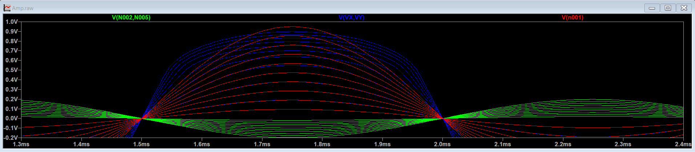

21/10/2026
- Initially when designed, the Iss current was much less than 200 uA (Target value). It is because the tail source transistor was not in saturation. To fix this, the Vin,cm for the input transistors have to be increased. The Vin,cm range had to be found and when Vin,cm approached ICMR+, Iss tends to 200 uA.

22/10/2026
- The simulated results were very close to the target and expected values.
- An interesting observation, when the input signal exceeds the maximum allowable value, the output doesn't distort and clip. The output distorts at a much larger input voltage. This results in a distorted sine wave at the output.

- Input Voltage is varied from 10m to 100m and it is observed that the output starts to distort when input is greater than 60 mV. According to calculations, the output should distort when input is greater than 28 mV. Note: Blue waveform is the differential output, Green waveform is the differential input and Red waveform is the expected differential output.

27/10/2026
- Upon careful inspection, the output cant seem to reach the desired value, once Vin>27.7 mV. If we keep on increasing Vin, the gain reduces and eventually the output clips. The gain reduction is because the MOS transistor is no longer in saturation.
- So, the previous observation might have been due to an error while simulating.

Note: Blue waveform is the differential output, Green waveform is the differential input and Red waveform is the expected differential output.

28/10/2026
- Calculated and simulated the common mode gain and estimated the CMRR. The common mode gain is only due to the finite output resistance of the tail current source. No other mismatch is present and thus common mode gain due to such mismatches is 0.
- Frequency response of the common mode is dictated by the intrinsic capacitors of the tail current source transistor and the load capacitor.