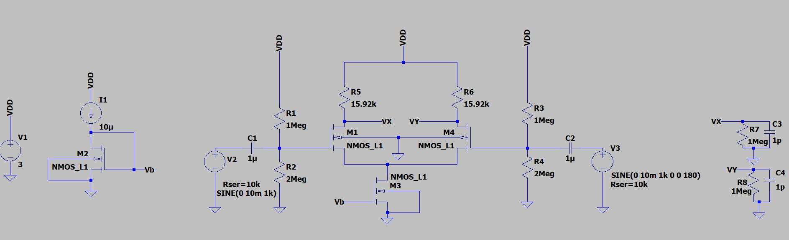
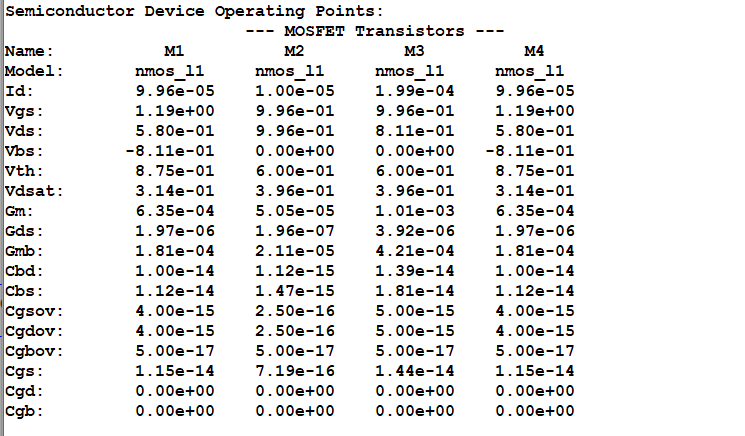
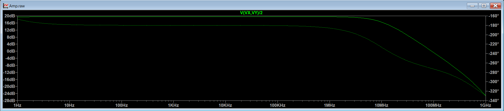
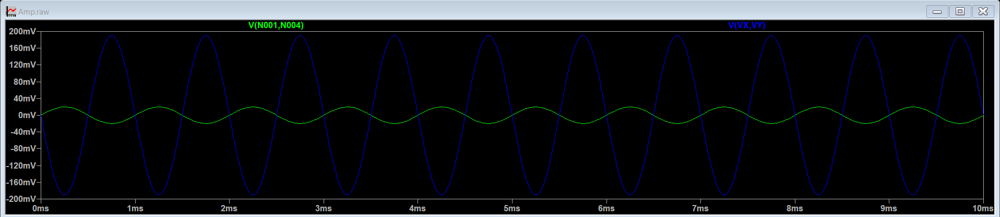
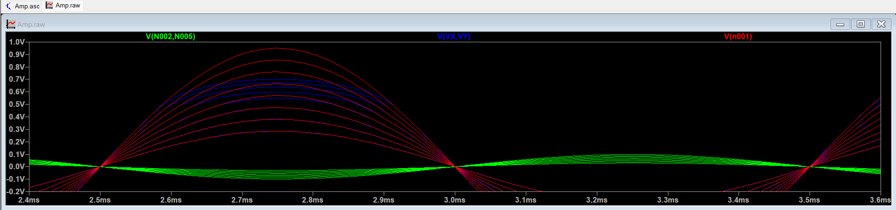

# Differential Amplifier with Resistive Load

## Overview

The project is targeted towards designing a differential amplifier with resistive load. Technology process node used for the design is 0.5µm. 

## Design Specifications

| Parameter                  | Symbol     | Given/Target Value | Unit |
| -------------------------- | ---------- | ------------------ | ---- |
| **Supply Voltage**         | $V_{DD}$   | 3                  | V    |
| **Bias Current Source**    | $I_{bias}$ | 10                 | µA   |
| **Power Budget**           | $P_{dc}$   | $\le$ 720          | µW   |
| **Technology Node**        | $L_{min}$  | 0.5                | µm   |
| **Voltage Gain**           | $A_v$      | 10                 | V/V  |
| **Gain Product Bandwidth** | $GB_W$     | 100                | MHz  |
| **Load Resistance**        | $R_L$      | 1                  | MΩ   |
| **Load Capacitance**       | $C_L$      | 1                  | pF   |

## Simulation Results

| Parameter                  | Expected / Target | Simulated Result | Deviation (%) | Remarks                                                                            |
| -------------------------- | ----------------- | ---------------- | ------------- | ---------------------------------------------------------------------------------- |
| **Gain (**$A_v$**)**       | 10 V/V            | 9.5 V/V          |               | Gain is lower because of the load resistance, and slight attenuation at the input. |
| **Gain Product Bandwidth** | 100 MHz           | 92.415 MHz       |               | -                                                                                  |
| **3-dB Bandwidth**         | 10 MHz            | 9.719 MHz        |               | -                                                                                  |
| **Power Consumption**      | $\le$ 720 µW      | 642.174 µW       | -             | The power budget is satisfied.                                                     |

## Schematics and Plots

### 1. Circuit Schematic

### 2. DC Analysis & Operating Point

### 3. AC Analysis (Bode Plot)

### 4. Transient Analysis

Transient Response with variation in input signal

Note: $V_{sig}$ is varied from 15 mV to 50 mV in steps of 5mV.

It is observed that when $V_{sig}$ goes beyond 25 mV, the output amplitude is lower than expected. As $V_{sig}$ increases, the difference between the expected output and the actual output increases and the output voltage clips eventually.
## Key Observations, Inferences & Takeaways

* **Biasing:** Biasing the tail current source requires a current mirror. The input MOS transistors cannot be biased directly using a current mirror, it is because the source of input transistor is not grounded, and thus a simple current mirror cannot be used as there will be a mismatch between VGS of the two transistors. Thus, a simple resistor divider is used to bias the input transistors. 

* **Sizing and Resistance Impact:** Sizing and drain resistance impacts both gain and bandwidth. Gain is proportional to $\sqrt{W/L}$ $R_{D}$  and bandwidth is proportional to $W^{-1}L^{-1}$ $R_{D}^{-1}$. 

- **Tail Current Source:** The lower end of the input voltage range is determined by the tail current source, as it is requires a certain minimum voltage across it for its operation, i.e., the tail current source transistor requires a minimum overdrive voltage across it so that it can remain in saturation.

## Note and Future Improvements

* **Note:** The MOS model used is a level 1 model, where the parameters chosen are arbitrary but realistically within the range. The model used for the 0.5µm node might not be realistic, but it provides for easy hand calculations and intuition for the design.

* **Future Work:**
  * Implementation using accurate and realistic BSIM3/BSIM4 models, and moving to a smaller technology nodes like 180nm.
  * Implementation using only transistors.
  
